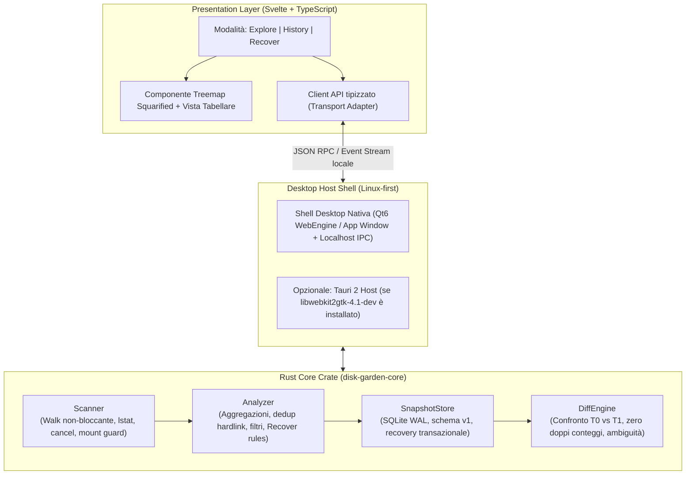

# Architettura Tecnica e Modello Dati — DiskGarden (Milestone 0)

**Stato:** Proposta Architetturale Verificata (Milestone 0)  
**Data:** 2026-10-21  
**Versione Schema Dati:** `v1`

---

## 1. Ispezione dell'ambiente di sviluppo

Prima di selezionare lo stack definitivo è stata eseguita una verifica puntuale dell'ambiente Linux di destinazione (`NeuronOS 1.0`, basato su Debian 13 `trixie`, kernel `7.0.10`).

### 1.1 Strumenti e librerie presenti
- **Toolchain Rust:** `rustc 1.97.1`, `cargo 1.97.1`, `clippy`, `rustfmt`.
- **Toolchain C/C++ & Build:** `gcc 14.2.0`, `libc6-dev 2.41`, `make`, `cmake`, `pkg-config 1.8.1`.
- **Toolchain Web/Frontend:** `node v22.22.3`, `npm 10.9.8`.
- **Database:** `libsqlite3-0` (`3.46.1`) presente a runtime (gli header `libsqlite3-dev` non sono installati a livello di sistema, ma sono pienamente supportati tramite compilazione statica della C amalgamation con `rusqlite` feature `bundled`).
- **Librerie grafiche e windowing native installate:**
  - **X11 / Wayland / GPU (`-dev` presenti):** `libwayland-dev 1.23.1`, `libx11-dev`, `libxkbcommon-dev`, `libxcursor-dev`, `libxrandr-dev`, `libxi-dev`, `libxinerama-dev`, `libegl-dev`, `libopengl-dev`, `libvulkan-dev`, `libfontconfig-dev`, `libfreetype-dev`.
  - **Qt6 + QtWebEngine (`-dev` e runtime presenti):** `qt6-base-dev 6.8.2`, `qt6-declarative-dev 6.8.2`, `qml-qt6`, `libqt6webenginecore6 6.8.2`, `libqt6webenginewidgets6`, `qml6-module-qtwebengine`, `python3-pyqt6`.
  - **Dialoghi nativi & Browser locale:** `kdialog`, `zenity`, `xdg-open`, `brave-browser`.

### 1.2 Criticità rilevata per Tauri 2 (`wry` / `webkit2gtk`)
- I pacchetti di sviluppo e runtime **`libwebkit2gtk-4.1-dev`** (né `libwebkit2gtk-4.1-0`), **`libgtk-3-dev`** e **`libsoup-3.0-dev`** **non sono installati** nell'ambiente corrente.
- Su Linux, Tauri 2 dipende obbligatoriamente da `webkit2gtk-4.1` e `gtk+-3.0` tramite `pkg-config` in fase di compilazione e a runtime. Senza privilegi di `root` (`sudo apt install libwebkit2gtk-4.1-dev libgtk-3-dev`), un binario Tauri 2 non può compilare su questa macchina.

---

## 2. Valutazione dello Stack e Decisione Architetturale

Per rispettare contemporaneamente:
1. Lo stack di riferimento (**Rust + Svelte + TypeScript + SQLite**),
2. Il principio **"Ogni milestone deve produrre software funzionante"** e **"Non richiedere privilegi di root"**,
3. La separazione netta tra Core Engine e Presentation Layer,

proponiamo un'architettura disaccoppiata in un **Cargo Workspace** con un'interfaccia IPC astratta che supporta tre modalità di shell desktop (da confermare con l'utente prima della Milestone 2):



### Opzioni per il Desktop Shell (Decisione da confermare per Milestone 2)

| Opzione | Descrizione tecnica | Vantaggi nell'ambiente attuale | Svantaggi |
| :--- | :--- | :--- | :--- |
| **Opzione A (Consigliata)**<br>**Rust Core + Svelte/TS + Desktop Shell Qt6 WebEngine / Local IPC** | Il binario Rust avvia il backend locale su `127.0.0.1:0` (con token di sessione effimero), incorpora gli asset Svelte/TS e apre una finestra desktop nativa Linux tramite `qml-qt6` (`QtWebEngine` preinstallato) o finestra app dedicata, usando `kdialog`/`zenity` per il file picker nativo. | - **Funziona subito senza `sudo`**.<br>- Mantiene **Rust + Svelte + TypeScript + SQLite**.<br>- 100% compatibile con Tauri 2 (stesso frontend e stesso core crate).<br>- Testabile end-to-end anche in modalità headless. | Usa `QtWebEngine` (Chromium-based, già installato nel sistema) invece di `WebKitGTK`. |
| **Opzione B**<br>**Tauri 2 puro** | Usa `tauri` crate + `Svelte` + `TypeScript`. | Stack di riferimento letterale della specifica. | **Bloccato sull'ambiente attuale** finché non vengono installati `libwebkit2gtk-4.1-dev` e `libgtk-3-dev` con privilegi di root. |
| **Opzione C**<br>**Rust Core + GUI Nativa Rust (`iced` o `eframe`/`egui`)** | Tutto in un singolo binario Rust compilato contro `libwayland-dev` e `libx11-dev` (già installati). | Singolo eseguibile nativo, zero dipendenze webview. | Meno flessibile per tipografia CSS avanzata, accessibilità DOM/ARIA e transizioni rispetto a Svelte + TypeScript. |

> [!IMPORTANT]
> **Impatto sulla Milestone 1:** La Milestone 1 riguarda esclusivamente il crate Rust **`disk-garden-core`** (`Scanner`, `Analyzer`, CLI di verifica e test su dataset sintetici). Pertanto la Milestone 1 è **completamente indipendente** dalla scelta tra Opzione A, B o C per la finestra GUI della Milestone 2.

---

## 3. Moduli Logici del Core (`disk-garden-core`)

Il codice di dominio è isolato nel crate `disk-garden-core` ed è diviso in quattro moduli con responsabilità rigorosamente separate.

### 3.1 `scanner` (`src/scanner/`)
Responsabile dell'attraversamento sicuro del filesystem Linux:
- **Usa esclusivamente `std::fs::symlink_metadata` (`lstat`)**: i link simbolici non vengono mai seguiti di default (`follow_symlinks = false`), rendendo strutturalmente impossibili i cicli infiniti da symlink.
- **Guardia di ciclo aggiuntiva:** mantiene un insieme `(st_dev, st_ino)` degli antenati attivi nel caso in cui l'opzione di attraversamento venisse mai abilitata o in presenza di bind mount anomali.
- **Controllo dei confini di filesystem (`stay_on_filesystem = true` di default):** registra lo `st_dev` della directory radice; se incontra una sottodirectory con `st_dev != root_st_dev`, la registra come entry con stato `AccessStatus::ExcludedMount` senza attraversarla automaticamente, a meno di scelta esplicita dell'utente (`cross_mounts = true`).
- **Distinzione delle dimensioni POSIX (`std::os::unix::fs::MetadataExt`):**
  - `apparent_bytes`: `metadata.len()` (`st_size`).
  - `allocated_bytes`: `metadata.blocks() * 512` (`st_blocks * 512`), che riflette i blocchi fisicamente allocati dal filesystem (gestendo nativamente i **file sparsi**, dove `allocated_bytes < apparent_bytes`).
- **Deduplicazione degli Hard Link (`st_nlink > 1`):**
  - Mantiene una mappa `SeenInodes: HashMap<(u64, u64), InodeRecord>` per la scansione corrente (`(st_dev, st_ino)`).
  - Alla prima occorrenza di un file con `st_nlink > 1`, i suoi byte allocati e apparenti vengono conteggiati normalmente nel totale fisico della scansione, e l'inode viene marcato come visto con l'elenco dei percorsi che lo referenziano.
  - Alle occorrenze successive dello stesso `(st_dev, st_ino)` nella stessa scansione, l'entry mantiene il proprio `apparent_bytes` e `allocated_bytes` informativo più il flag `is_hardlink_duplicate = true` e `shared_inode_paths_count = k`, ma **l'aggregatore non somma una seconda volta i blocchi fisici ai totali delle directory antenate**, evitando di sovrastimare lo spazio fisico occupato.
- **Gestione degli errori non distruttiva:**
  - `PermissionDenied` (`EACCES` / `EPERM`), `NotFound` (`ENOENT` per file rimossi durante la scansione / *vanished*), e altri `IoError` vengono catturati per singola entry e registrati con `AccessStatus` specifico e contatori aggregati (`unreadable_dirs_count`, `io_errors_count`, `vanished_count`).
  - Se almeno una sottodirectory o entry genera `PermissionDenied` o `IoError`, la scansione termina con stato **`ScanStatus::Partial`** (mai `Completed`), distinguendo chiaramente le directory vuote (`0 B, status = Ok`) dalle directory non leggibili (`status = PermissionDenied`).
- **Annullamento cooperativo e streaming del progresso:**
  - Riceve un `Arc<AtomicBool>` (`cancel_flag`) verificato a ogni iterazione e un canale di progresso con throttling temporale (es. ogni 100 ms) che emette `ScanProgress { dirs_scanned, files_scanned, apparent_bytes_so_far, allocated_bytes_so_far, errors_count, current_path }` senza bloccare il thread UI.
  - Se `cancel_flag` diventa `true`, lo scanner interrompe immediatamente la visita e restituisce `ScanStatus::Cancelled`.

### 3.2 `analyzer` (`src/analyzer/`)
Responsabile dell'elaborazione analitica in memoria o da snapshot:
- **Aggregazione bottom-up dei sottoalberi:** calcola per ogni directory:
  - `subtree_apparent_bytes` e `subtree_allocated_bytes` (al netto dei duplicati hard link già contati nel sottoalbero).
  - `direct_files_bytes` (spazio dei file figli immediati della directory).
  - `descendant_files_count` e `descendant_dirs_count`.
  - `subtree_error_count` (numero di errori o directory inaccessibili contenuti nel sottoalbero, propagato verso la radice affinché l'utente veda subito quali rami sono parziali).
- **Ordinamento e Top-N:** estrazione rapida dei Top-N file più grandi, Top-N directory più grandi, distribuzione per estensione/categoria.
- **Preparazione dati per la Treemap (`TreemapLayoutBuilder`):**
  - Limita la profondità renderizzata contemporaneamente (es. livello corrente + 1 livello di figli) e raggruppa automaticamente nella coda un nodo sintetico navigabile `"Altri N elementi minori (< 0.5%)"` quando una directory contiene centinaia o migliaia di file piccoli, garantendo fluidità costante a 60 fps anche su directory con > 100.000 file.
- **Motore di analisi `Recover` (Regole deterministiche e trasparenti):**
  - Identifica candidate directory e file con tre metriche separate:
    1. `detected_occupied_bytes` (spazio allocato rilevato).
    2. `potentially_recoverable_bytes` (spazio associato a pattern noti e documentati di cache/artefatti rigenerabili, con indicazione della regola esatta, es. `Rule::XdgUserCache`, `Rule::CargoTargetDir`, `Rule::NodeModulesCache`, `Rule::PythonBytecodeCache`).
    3. `verified_recoverable_bytes` (spazio allocato che appartiene ad inode i cui hard link noti risiedono interamente dentro il sottoalbero candidato e il cui sottoalbero ha `subtree_error_count == 0`).

### 3.3 `snapshot_store` (`src/snapshot_store/`)
Responsabile della persistenza locale su SQLite:
- **Singolo database locale SQLite** (percorso predefinito XDG: `$XDG_DATA_HOME/disk-garden/snapshots.db` o configurabile nei test).
- **Sicurezza transazionale e crash recovery:**
  - Connessione configurata con `PRAGMA journal_mode = WAL; PRAGMA synchronous = NORMAL; PRAGMA foreign_keys = ON; PRAGMA busy_timeout = 5000;`.
  - Durante il salvataggio, lo snapshot viene creato con `status = 'saving'` dentro una transazione o fase preparatoria; solo al commit finale di tutte le entry lo stato passa a `'completed'` o `'partial'`.
  - Le scansioni con stato `'cancelled'` non vengono salvate come snapshot confrontabili (o, se richiesto il log, sono marcate `'cancelled'` e rifiutate dal `DiffEngine`).
  - All'avvio dell'applicazione, una routine di recovery (`cleanup_interrupted_snapshots`) individua eventuali snapshot rimasti in stato `'saving'` a causa di una chiusura imprevista (crash/SIGKILL) e li rimuove o marca come `'interrupted'`, preservando l'integrità del DB.
- **Versionamento dello schema:** tabella `schema_migrations` con versione intera esplicita (`SCHEMA_VERSION = 1`).

### 3.4 `diff_engine` (`src/diff_engine/`)
Responsabile del confronto autorevole tra due snapshot ($S_{\text{base}}$ a $T_0$ e $S_{\text{target}}$ a $T_1$):
- **Verifica preliminare di compatibilità (`CompatibilityCheck`):**
  - Rifiuta il confronto se le radici canoniche (`root_path_raw`) non coincidono.
  - Rifiuta il confronto se uno dei due snapshot è `cancelled` o `interrupted`.
  - Se uno dei due snapshot ha stato `partial` o opzioni di mount differenti (`cross_mounts`), emette un avviso strutturato (`DiffReliability::PartialWarning`) e marca come `Uncomparable` i sottoalberi affetti da errori di accesso.
- **Classificazione delle differenze per entry (`DiffKind`):**
  - `Added`: presente in $T_1$, assente in $T_0$ (e il genitore in $T_0$ era leggibile).
  - `Removed`: presente in $T_0$, assente in $T_1$ (e il genitore in $T_1$ è leggibile).
  - `Grown`: presente in entrambi con lo stesso tipo, $\Delta \text{allocated} > 0$ o $\Delta \text{apparent} > 0$.
  - `Shrunk`: presente in entrambi con lo stesso tipo, $\Delta \text{allocated} < 0$ o $\Delta \text{apparent} < 0$.
  - `MetadataModifiedSameSize`: presente in entrambi con $\Delta \text{apparent} = 0$ e $\Delta \text{allocated} = 0$, ma `mtime` o `ino` cambiato. **Non viene mai classificato come file cresciuto**, né dichiarato con certezza come contenuto modificato senza hash.
  - `TypeChanged`: es. era un file in $T_0$ ed è diventato una directory o symlink in $T_1$.
  - `Uncomparable`: il percorso o una sua directory antenata aveva `AccessStatus != Ok` (es. `PermissionDenied` o `ExcludedMount`) in $T_0$ o in $T_1$.
- **Prevenzione dei doppi conteggi nei totali di crescita:**
  - Per ogni directory $D$, il `DiffEngine` distingue:
    - `direct_delta_bytes(D)`: somma delle variazioni dei soli file figli diretti di $D$.
    - `subtree_delta_bytes(D)`: variazione totale dell'intero sottoalbero radicato in $D$ ($\text{size}_{T_1}(D) - \text{size}_{T_0}(D)$).
  - La variazione netta globale tra $T_0$ e $T_1$ è data esclusivamente da $\sum_f \Delta(f)$ sui file (oppure $\text{subtree\_delta}(\text{root})$), **mai** dalla somma dei `subtree_delta` di directory annidate.

---

## 4. Gestione Sicura dei Percorsi Linux (Unicode e Non-UTF-8)

Su Linux (POSIX), un nome di file o percorso è una sequenza arbitraria di byte (`[u8]`) priva del byte nullo `0x00` e separata da `/` (`0x2F`), che **non è garantita essere UTF-8 valido**.

Per rispettare il requisito obbligatorio della Sezione 8:
1. **In Rust (`disk-garden-core`):** tutti i percorsi del filesystem sono manipolati come `PathBuf` / `OsString` e serializzati nella forma canonica grezza tramite `std::os::unix::ffi::OsStrExt::as_bytes() -> &[u8]`.
2. **In SQLite (`SnapshotStore`):** ogni percorso relativo alla radice è memorizzato con tre campi:
   - `rel_path_raw BLOB NOT NULL`: i byte esatti POSIX del percorso relativo (usati per l'identità univoca, gli indici e il join/confronto esatto nel `DiffEngine`).
   - `rel_path_display TEXT NOT NULL`: rappresentazione `String::from_utf8_lossy` (con `U+FFFD ` per eventuali byte non-UTF-8) usata per la visualizzazione UI e la ricerca testuale.
   - `is_valid_utf8 INTEGER NOT NULL`: `1` se il percorso è UTF-8 valido, `0` se contiene sequenze di byte non-UTF-8 (in modo che la UI possa mostrare un badge informativo e usare l'ID o i byte raw per le operazioni IPC).
3. **Zero Shell Execution:** nessuna funzione del codice invoca `sh`, `bash` o `Command::new` interpolando stringhe di percorsi; l'apertura nel file manager di sistema (quando richiesta dall'utente) passa i `PathBuf`/`OsStr` direttamente alle API di processo argv senza shell.

---

## 5. Modello Dati Iniziale — Schema SQLite `v1`

Di seguito è riportata la specifica completa dello schema SQLite `v1` gestito da `SnapshotStore`.

```sql
-- Metadati di versione dello schema
CREATE TABLE IF NOT EXISTS schema_migrations (
    version INTEGER PRIMARY KEY NOT NULL,
    applied_at TEXT NOT NULL
);

-- Tabella principale delle Snapshot
CREATE TABLE IF NOT EXISTS snapshots (
    id INTEGER PRIMARY KEY AUTOINCREMENT,
    schema_version INTEGER NOT NULL DEFAULT 1,
    -- Percorso assoluto canonico della radice (byte grezzi POSIX + display UTF-8 lossy)
    root_path_raw BLOB NOT NULL,
    root_path_display TEXT NOT NULL,
    label TEXT,
    created_at_unix_ms INTEGER NOT NULL,
    scan_duration_ms INTEGER NOT NULL DEFAULT 0,
    -- Stato: 'saving' | 'completed' | 'partial' | 'cancelled' | 'interrupted'
    status TEXT NOT NULL CHECK (status IN ('saving', 'completed', 'partial', 'cancelled', 'interrupted')),
    -- Parametri di compatibilità della scansione
    root_dev INTEGER NOT NULL,
    cross_mounts INTEGER NOT NULL DEFAULT 0,
    follow_symlinks INTEGER NOT NULL DEFAULT 0,
    -- Metriche aggregate della radice (deduplicate per hard link)
    total_apparent_bytes INTEGER NOT NULL DEFAULT 0,
    total_allocated_bytes INTEGER NOT NULL DEFAULT 0,
    total_files_count INTEGER NOT NULL DEFAULT 0,
    total_dirs_count INTEGER NOT NULL DEFAULT 0,
    total_symlinks_count INTEGER NOT NULL DEFAULT 0,
    hardlink_saved_bytes INTEGER NOT NULL DEFAULT 0,
    unreadable_dirs_count INTEGER NOT NULL DEFAULT 0,
    io_errors_count INTEGER NOT NULL DEFAULT 0
);

CREATE INDEX IF NOT EXISTS idx_snapshots_root_status
    ON snapshots(root_path_raw, status, created_at_unix_ms DESC);

-- Tabella delle entry del filesystem appartenenti a uno snapshot
CREATE TABLE IF NOT EXISTS snapshot_entries (
    id INTEGER PRIMARY KEY AUTOINCREMENT,
    snapshot_id INTEGER NOT NULL REFERENCES snapshots(id) ON DELETE CASCADE,
    -- Percorso relativo alla radice (vuoto b"" per la radice stessa)
    rel_path_raw BLOB NOT NULL,
    rel_path_display TEXT NOT NULL,
    parent_rel_path_raw BLOB,
    name_display TEXT NOT NULL,
    is_valid_utf8 INTEGER NOT NULL DEFAULT 1,
    depth INTEGER NOT NULL,
    -- Tipo elemento: 'dir' | 'file' | 'symlink' | 'other'
    entry_type TEXT NOT NULL CHECK (entry_type IN ('dir', 'file', 'symlink', 'other')),
    -- Dimensioni del singolo elemento (o del sottoalbero per le directory)
    apparent_bytes INTEGER NOT NULL DEFAULT 0,
    allocated_bytes INTEGER NOT NULL DEFAULT 0,
    subtree_apparent_bytes INTEGER NOT NULL DEFAULT 0,
    subtree_allocated_bytes INTEGER NOT NULL DEFAULT 0,
    -- Conteggi aggregati (popolati per entry_type = 'dir')
    subtree_files_count INTEGER NOT NULL DEFAULT 0,
    subtree_dirs_count INTEGER NOT NULL DEFAULT 0,
    subtree_error_count INTEGER NOT NULL DEFAULT 0,
    -- Metadati POSIX per confronto temporale e rilevazione hard link
    dev INTEGER,
    ino INTEGER,
    nlink INTEGER NOT NULL DEFAULT 1,
    is_hardlink_duplicate INTEGER NOT NULL DEFAULT 0,
    mtime_sec INTEGER,
    mtime_nsec INTEGER,
    -- Stato di accesso: 'ok' | 'permission_denied' | 'io_error' | 'vanished' | 'excluded_mount' | 'symlink_skipped'
    access_status TEXT NOT NULL CHECK (
        access_status IN ('ok', 'permission_denied', 'io_error', 'vanished', 'excluded_mount', 'symlink_skipped')
    ),
    error_message TEXT,
    UNIQUE(snapshot_id, rel_path_raw)
);

CREATE INDEX IF NOT EXISTS idx_entries_snapshot_parent
    ON snapshot_entries(snapshot_id, parent_rel_path_raw);

CREATE INDEX IF NOT EXISTS idx_entries_snapshot_type_size
    ON snapshot_entries(snapshot_id, entry_type, subtree_allocated_bytes DESC);
```

### Limitazioni documentate del Modello Dati v1
1. **Rilevazione rinomine/spostamenti senza hash:** Poiché l'MVP esclude l'hashing completo dei file, un file rinominato da `a.iso` a `b.iso` viene visto per percorso relativo come `Removed(a.iso)` + `Added(b.iso)`. Tuttavia, poiché memorizziamo `(dev, ino, mtime_sec, apparent_bytes)`, il `DiffEngine` può segnalare come **suggerimento di possibile rinomina/spostamento** una coppia `Removed`/`Added` nella stessa snapshot pair che condivide lo stesso `(dev, ino)` e la stessa dimensione!
2. **Hard link con riferimenti esterni alla radice scansionata:** Se un file dentro `/home/user/progetto` ha `st_nlink = 2` e il secondo link si trova fuori da `/home/user/progetto` (es. in `/home/user/backup`), lo scanner rileva `nlink = 2` ma vede solo `1` occorrenza nel sottoalbero scansionato. Di conseguenza, in `Recover` lo spazio di quel file viene classificato come *Spazio occupato rilevato* ma **non** come *Spazio recuperabile effettivamente verificato* (perché l'eliminazione del solo link interno non libererebbe i blocchi su disco).
3. **Filesystem virtuali o compressi (`btrfs`, `zfs`, `procfs`, `sysfs`):** Su `btrfs`/`zfs` con compressione trasparente o CoW reflinks (`FICLONE`), `st_blocks * 512` riflette i blocchi riportati dal driver POSIX ma non può conoscere la deduplicazione interna a livello di extent CoW senza chiamate `ioctl` privilegiate (`FIEMAP`/`BTRFS_IOC_TREE_SEARCH`). Questo limite è esplicitato nella UI e nella documentazione.
